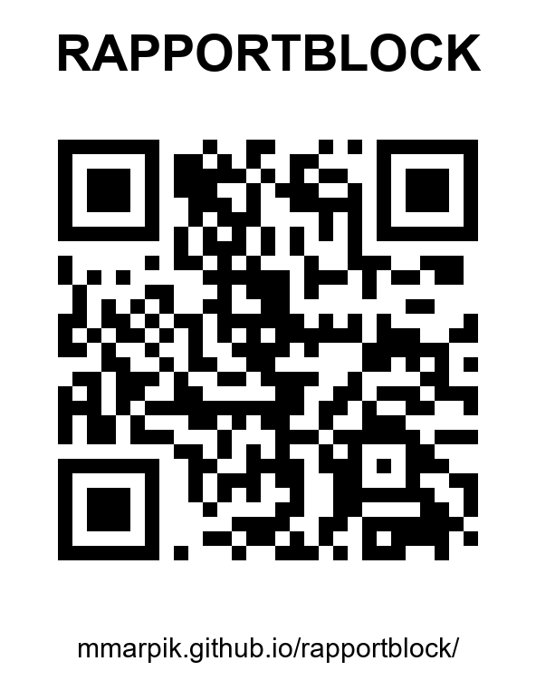

# Rapportblock

Fickblock i mobilen för hemvärnets vanligaste rapporter och instruktioner. Snabbval och fritext, uppläsningsläge för radio, och logg.

**Öppna:** https://mmarpik.github.io/rapportblock/

## Innehåll

FORS, BSÖ och 7S/8S ligger som knappar. Övriga finns i menyn **Fler**.

| Grupp | Formulär |
|---|---|
| Rapporter (sänds på radio) | FORS, 7S/8S, PEDARS |
| Instruktioner (sägs till soldaterna) | OBO, Marschorder, ERER/EKER, EOBUSARE, BSÖ, OBSLÖSA |
| Kontroll | 8F |

## Installera på telefonen

1. Öppna länken i Chrome (Android) eller Safari (iPhone).
2. Välj **Lägg till på startskärmen**.
3. Öppna appen en gång med täckning. Därefter fungerar den även offline.

## Var sparas rapporterna?

Bara i telefonens webbläsare. Inget skickas någonstans. Under **Logg** finns **Exportera** (sparar loggen som en JSON-fil) och **Importera** (läser in en sådan fil, utan dubbletter). Använd det som säkerhetskopia eller för att flytta loggen till en ny telefon.

Skriv inte in hemliga uppgifter, till exempel lösen.

## Teknik

En enda HTML-fil utan byggsteg, plus `sw.js` för offline och `manifest.webmanifest` för installation. Formulären definieras som data i `FORMS` i `index.html`. Höj `CACHE` i `sw.js` när filerna ändras.
